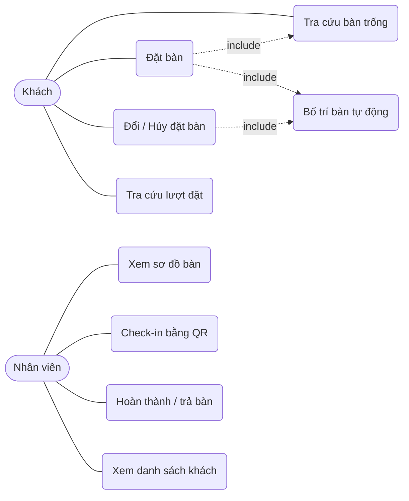

# Bước 1 – Phân tích đặc tả yêu cầu

## 1. Tóm tắt đặc tả (từ file đặc_tả.xlsx – Đề tài 7)
| Mục | Nội dung |
|-----|----------|
| Input | Khách hàng; bàn; khu vực; thời gian; số người; trạng thái bàn |
| Processing | Tra cứu; kiểm tra khả dụng; đặt/đổi/hủy; bố trí bàn; check-in |
| Output | Xác nhận đặt bàn; trạng thái bàn; danh sách khách |
| Bắt buộc | Business rules; SRS; Use Case; Activity; Class/ERD; Sequence; UI prototype |
| Mở rộng | Web/App đặt bàn; sơ đồ bàn tương tác; QR check-in |

## 2. Business rules
| Mã | Quy tắc |
|----|---------|
| BR01 | Nhà hàng mở 10:00–22:00; lượt đặt phải kết thúc trước 22:00 |
| BR02 | Mỗi lượt đặt kéo dài 90 phút |
| BR03 | Giữa 2 lượt trên cùng một bàn phải cách nhau ít nhất 15 phút (dọn bàn); không được đặt trùng |
| BR04 | Phải đặt trước ít nhất 60 phút và tối đa 30 ngày |
| BR05 | Số người 1–20; sức chứa bàn ≥ số người; hệ thống xếp bàn vừa nhất (nhỏ nhất đủ chỗ) |
| BR06 | Chỉ đổi/hủy khi còn ≥ 2 giờ trước giờ đặt và lượt đặt đang ở trạng thái "Đã xác nhận" |
| BR07 | Check-in từ 15 phút trước đến 15 phút sau giờ đặt; quá hạn → "Vắng mặt", bàn được giải phóng |
| BR08 | Khách được định danh bằng số điện thoại (10–11 số, bắt đầu bằng 0); khách cũ không bị tạo trùng |
| BR09 | Bàn đang bảo trì không được xếp cho khách |

Vòng đời lượt đặt: `Đã xác nhận → Đã check-in → Hoàn thành`; nhánh phụ: `Đã xác nhận → Đã hủy / Vắng mặt`.

## 3. SRS – yêu cầu
**Chức năng**
| Mã | Yêu cầu | Tác nhân |
|----|---------|----------|
| FR01 | Tra cứu bàn trống theo ngày giờ, số người, khu vực | Khách |
| FR02 | Đặt bàn, nhận mã xác nhận + QR | Khách |
| FR03 | Đổi giờ/số người, hủy đặt bàn | Khách |
| FR04 | Tra cứu lượt đặt theo mã hoặc số điện thoại | Khách |
| FR05 | Tự động bố trí bàn theo BR05 | Hệ thống |
| FR06 | Check-in bằng quét QR; hoàn thành/trả bàn | Nhân viên |
| FR07 | Xem sơ đồ bàn tương tác theo thời điểm | Nhân viên |
| FR08 | Xem danh sách khách theo ngày | Nhân viên |
| FR09 | Tự đánh dấu vắng mặt khi quá hạn check-in | Hệ thống |
| FR10 | Ghi nhật ký mọi thao tác | Hệ thống |

**Phi chức năng:** NFR01 không bao giờ đặt trùng bàn dù nhiều người đặt cùng lúc (khóa dòng + giao dịch); NFR02 phản hồi < 2 giây; NFR03 giao diện tiếng Việt, dùng được trên điện thoại; NFR04 dữ liệu lưu UTF-8 (utf8mb4).

## 4. Use Case

**Đặc tả UC02 – Đặt bàn:** Tiền điều kiện: có bàn trống. Luồng chính: (1) khách nhập ngày giờ, số người, khu vực → (2) hệ thống liệt kê bàn trống → (3) khách chọn bàn hoặc để hệ thống tự xếp → (4) nhập họ tên, SĐT → (5) hệ thống kiểm tra BR01–BR05, BR08 → (6) lưu, sinh mã + QR. Luồng thay thế: dữ liệu vi phạm rule → báo lỗi, giữ lại form; hết bàn → gợi ý chọn giờ khác. Hậu điều kiện: bàn bị giữ trong khung giờ đặt.

## 5. User story & tiêu chí chấp nhận (rút gọn)
- Là khách, tôi muốn xem bàn trống theo giờ để chọn chỗ phù hợp. *Chấp nhận:* danh sách chỉ gồm bàn đủ chỗ, không trùng lịch.
- Là khách, tôi muốn hủy khi đổi kế hoạch. *Chấp nhận:* hủy được nếu còn ≥ 2 giờ, bàn được trả lại ngay.
- Là nhân viên, tôi muốn quét QR để check-in nhanh. *Chấp nhận:* quá sớm/muộn bị từ chối kèm lý do.

## 6. Công nghệ và rủi ro
Python 3 + Flask, MySQL 8, `mysql-connector-python`, `qrcode`, pytest. Rủi ro chính: hai khách đặt trùng một bàn cùng lúc → xử lý bằng `SELECT ... FOR UPDATE` trong giao dịch.
