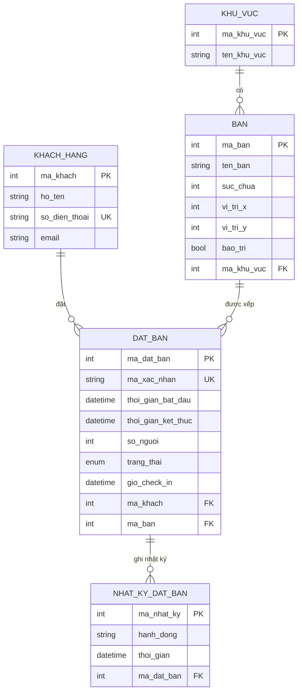
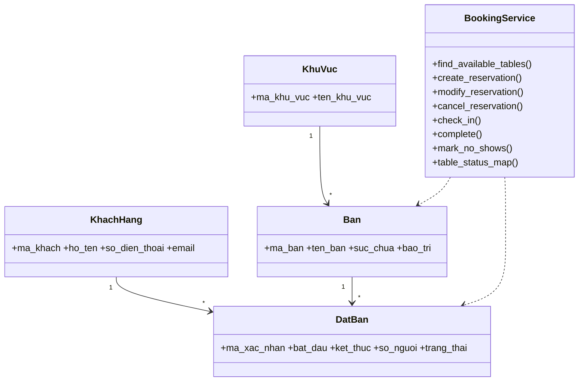
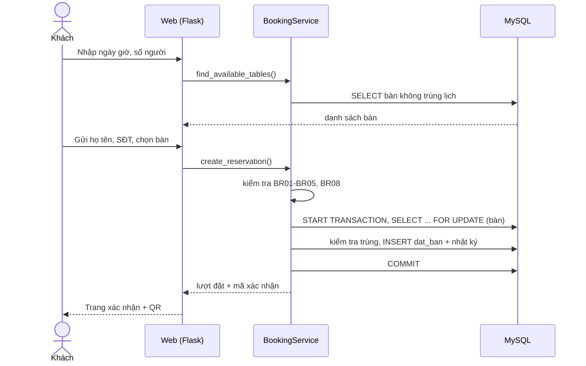
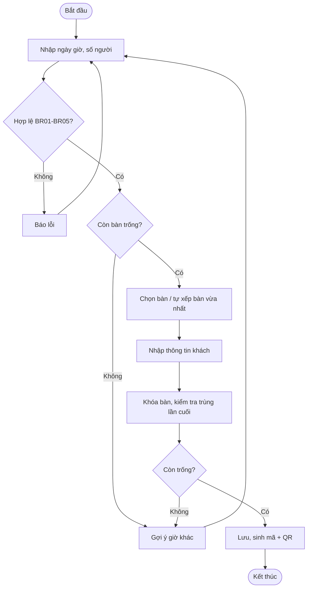

# Bước 2 – Thiết kế

## 1. ERD

Trạng thái bàn **không lưu cứng**: được suy ra từ các lượt đặt tại thời điểm xem (tránh dữ liệu lệch).

## 2. Class diagram

## 3. Sequence – Đặt bàn

## 4. Activity – Đặt bàn

**Sequence check-in (tóm tắt):** Nhân viên quét QR → `GET /check-in/<mã>` → bấm xác nhận → `check_in()` kiểm tra BR07 → cập nhật `DA_CHECK_IN` + ghi nhật ký.

## 5. Kiến trúc
3 tầng: **Giao diện** (Jinja + JS) → **Nghiệp vụ** (`services.py`, mọi business rule ở đây) → **Dữ liệu** (`db.py` + MySQL). Cấu hình rule tập trung trong `config.py`.

| Route | Chức năng |
|-------|-----------|
| `GET /`, `GET /api/availability` | Form đặt bàn, bàn trống |
| `POST /dat-ban`, `GET /xac-nhan/<mã>` | Đặt bàn, xác nhận + QR |
| `POST /doi/<mã>`, `POST /huy/<mã>` | Đổi / hủy |
| `/tra-cuu` | Tra cứu theo mã hoặc SĐT |
| `/nhan-vien`, `/api/so-do-ban` | Sơ đồ bàn + danh sách khách |
| `/check-in/<mã>` | Trang đích của QR |

## 6. Truy vết yêu cầu → thiết kế
FR01→`find_available_tables`; FR02/FR05→`create_reservation`; FR03→`modify/cancel`; FR04→`/tra-cuu`; FR06→`check_in/complete`; FR07→`table_status_map`; FR08→`guest_list`; FR09→`mark_no_shows`; FR10→bảng `nhat_ky_dat_ban`.

## 7. UI prototype (4 màn hình)
1. **Đặt bàn:** ngày giờ + số người + khu vực → nút bàn trống → họ tên, SĐT → xác nhận.
2. **Xác nhận:** mã, thông tin lượt đặt, mã QR, form đổi/hủy.
3. **Tra cứu:** ô nhập mã/SĐT → bảng lượt đặt.
4. **Nhân viên:** sơ đồ bàn theo khu vực (xanh=trống, vàng=đã đặt, đỏ=đang phục vụ, xám=bảo trì), chọn thời điểm, danh sách khách theo ngày.
(Bản chạy thật nằm trong `app/templates/`.)
